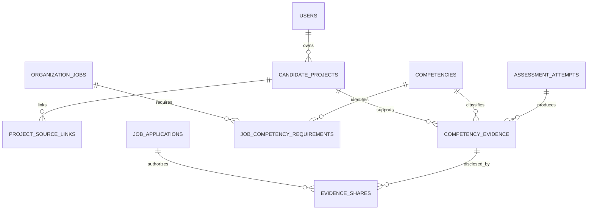

# Proofpath evidence-first MVP

This document describes the implemented evidence-first workflow. The updated commercial scope and current product roadmap are in [PRODUCT_SCOPE.md](PRODUCT_SCOPE.md), [PORTFOLIO_SUBSCRIPTIONS.md](PORTFOLIO_SUBSCRIPTIONS.md), and [IMPLEMENTATION_PROGRESS.md](IMPLEMENTATION_PROGRESS.md).

## Product objective

Reduce repeat hiring assessments by showing employers which role-specific competencies a candidate claims, which have evidence, how that evidence was produced, and what remains unverified. Deterministic test results and human review are separate from candidate statements and any future AI assistance. An authorized human makes the hiring decision.

The implemented assessment track focuses on Python and FastAPI backend engineering. The previous 217-operation API inventory remains a historical design catalog, not the delivery target. This document records that evidence-first slice; the updated portfolio and subscription roadmap is tracked in `PRODUCT_SCOPE.md` and `IMPLEMENTATION_PROGRESS.md`.

## Repository audit

- The active product is a set of standalone HTML pages served by FastAPI and wrapped by the Next.js route shell. Candidate projects, public portfolios (`/u/{handle}`, with `/portfolio/{handle}` retained for compatibility), jobs, applications, assessment drafts, invitations, and attempt readiness already have browser/API workflows.
- PostgreSQL migrations 001–022 provide identity, tenant membership, candidate projects/source links, consented portfolio publication and stable public handles, jobs/applications, immutable assessment versions, invitations, attempts, reviewer assignments, a stable competency catalog, private project claims, job competency requirements, attempt consent, deterministic test runs/evidence, and application-scoped evidence-sharing history.
- Project content and GitHub root URLs are candidate-submitted. Repository content is not fetched and ownership is not verified.
- Assessment definitions preserve their author-facing competency names and can link each one to a stable Python/FastAPI competency ID. Invitation and attempt consent are persisted with explicit versioning; recording is disabled. Candidate code runs only through the local rootless Podman runner.
- Competency IDs classify private candidate-authored claims, test evidence and explicit job requirements. Candidates can share selected evidence per application; deterministic employer reports require an owner/admin or assigned recruiter and show only the current grant.
- Disconnected static design references and the hard-coded sample workspace were removed. The candidate dashboard and assessment evidence views use the connected product workflows.

## Data relationships

All competency IDs are stable catalog codes scoped to the Python/FastAPI track. Candidate project claims create private evidence records with `verification_method=self_reported`, `review_status=unreviewed`, a candidate statement, and an explicit limitation that no repository contents or result were independently verified. Editing a claim withdraws the prior record and creates a replacement; it never upgrades verification status. GitHub links remain metadata, not proof.

Assessment evidence references a persisted attempt, exact test-run snapshot and competency. Only isolated-runner deterministic outputs can be labeled automated-test evidence; human review is a separate record/action. Employer disclosure is application-scoped, candidate-authorized, append-only and revocable. Public portfolio consent does not silently grant access to private evidence.

## Minimum API surface and authorization

| Slice | API surface | Access rule | Key acceptance checks |
| --- | --- | --- | --- |
| Competency catalog and project claims | `GET /api/v1/competencies`; extend existing `GET/POST /api/v1/me/projects` and `PATCH /api/v1/me/projects/{project_id}` | Catalog is public and read-only. Claims are candidate-owned, CSRF-protected on writes, versioned with their project, and hidden from public portfolio/application snapshots until separately consented. | Stable active Python/FastAPI competencies; input allowlist; tenant/owner isolation; idempotent create; immutable claim history; no verified label; invalid or retired codes rejected. |
| Job requirements | Extend organization job draft create/update/read with competency code, target level, accepted evidence types, and freshness policy | Same organization owner/admin/recruiter write policy as jobs; public job requirements only after publication. | Unique requirements; competency codes in the supported track; optimistic version check; requirement changes do not mutate existing application snapshots. |
| Controlled assessment | Reuse assessment authoring, invitation, consent, and attempt APIs; optional stable competency IDs are included in the frozen assessment definition | Organization scope; candidate must accept the exact version; runner receives only the assigned task and bounded workspace. | Explicit consent; repeat-safe attempt transitions; resource/time limits; no host secrets or network access; deterministic results with run provenance. Local rootless Podman controls are tested; escape resistance and production runtime mapping are not. |
| Evidence and gap analysis | Persist deterministic test outcomes, allow application-scoped candidate sharing, compute a deterministic per-job competency report | Candidate reads own evidence. An employer reads only evidence shared for this application; organization membership and reviewer assignment remain enforced. | Explain each state with source, outcome, limitations, freshness and policy; candidate statements never satisfy verified requirements. Implemented; focused recommendation remains next. |
| Focused follow-up and employer review | Reuse published assessment invitation and application review; add evidence share/report endpoints only where existing routes cannot express the contract | Candidate consent gates each disclosure; assigned reviewers see only authorized evidence; owner/admin makes final hiring decision. | Recommend an unused published deterministic assessment for unresolved accepted competencies at the required level; report links each conclusion to evidence and policy. |

## Dependency order

1. **Competency catalog and self-reported project evidence.** Implemented. Stable IDs classify candidate-authored project claims that stay unverified and candidate-private.
2. **Job competency requirements.** Implemented. Job drafts/publications carry IDs, target levels, accepted evidence methods, freshness and application-time policy snapshots.
3. **Assessment competency alignment.** Implemented. Each free-text assessment competency can optionally link to one stable catalog ID; active IDs are validated on create/update and frozen in published versions. Existing unlinked assessment definitions remain compatible.
4. **Isolated practical execution.** Implemented for a single Python function per assessment: versioned private workspace, frozen server-side cases, and rootless Podman execution with no network, read-only root, resource limits, and sanitized results. Run records and code hashes persist; execution is synchronous and has no worker queue.
5. **Evidence records and deterministic gap matcher.** Every competency test outcome creates candidate-only deterministic-test evidence with run provenance. Compare requirements to eligible evidence using explicit rules and expose reasons and limitations, not opaque scores.
6. **Candidate evidence sharing and employer report.** Implemented. Capture candidate-approved disclosure per application, expose only selected evidence to authorized hiring reviewers, and return explained demonstrated, insufficient, and unverified requirement states. Revocation removes future API access.
7. **Focused follow-up and workflow validation.** Implemented for existing published assessments: recommend only assessments with deterministic cases for unresolved requirements, adequate target levels, and no prior invitation on that application. Browser and API flows verify the candidate can complete the recommendation and the employer can review or revoke shared evidence.
8. **MVP operations gate.** Verify migrations/backups, retention and deletion behavior, shared rate limits, real email configuration, accessibility, production secrets, sandbox monitoring, and recovery before deployment.

## First slice acceptance criteria

- Candidate can select a stable competency and explain how a private project relates to it.
- The API persists the claim as self-reported, unreviewed, candidate-only evidence with its project and limitation linked.
- Candidate can update claims using the existing project version check; old claims are withdrawn, not rewritten or upgraded.
- Unknown or out-of-track competency codes are rejected. Another user cannot read or change the evidence.
- Portfolio and application snapshots do not disclose these claims without a separate explicit sharing contract.
- Existing project create requests without competency claims remain compatible.
- API schemas and docs describe the actual response, and database/API/browser tests cover the behavior.

## Implemented job requirement slice

Organization owners, admins, and recruiters can set up to eight distinct, active Python/FastAPI competency requirements while creating or updating a job. Each requirement records a target level, one or both accepted methods (`deterministic_test`, `human_review`), and evidence age in days. `self_reported` is rejected. Requirements are returned to authorized organization members and included in public job DTOs only after publication. The application transaction locks the published job while copying its requirement list into the immutable job snapshot, so later job edits do not change what an existing applicant applied against. The public job and application review pages show those policies. This configures hiring criteria; it does not yet evaluate candidate evidence against them.

Acceptance is covered by database-backed validation, publication, application snapshot, and frontend flow tests. Existing job requests without requirements remain valid.

## Explicit non-goals for this MVP

The previous full-platform catalog, OAuth repository ingestion, file uploads, generalized professions, AI candidate rankings, interview scheduling/recording, public skill badges, broad analytics, and production deployment are not prerequisites for this evidence workflow. No candidate code will run in the API process or on the host.

## Current status

The historical catalog has 80 implemented operations; the public competency catalog and three application evidence endpoints are additional MVP operations outside that original 217-operation inventory. Migrations 017 and 018 add private project claims and job requirements; 020 adds workspaces/test runs/evidence provenance; 021 adds application-scoped sharing history; 022 locks existing and newly published profile handles. The local preview uses a dedicated development database and is available at `http://127.0.0.1:8000`; its terms configuration is local-preview-only. This is not a production deployment.

## Implemented controlled assessment slice

Organization authors may attach up to six JSON test cases to a published Python assessment. Every case maps to a catalog-linked competency. Candidate briefing responses include the entrypoint but strip the private inputs and expected values. A candidate must accept attempt consent before opening the single-file workspace. Saves use expected versions; test runs use an idempotency key, freeze the submitted code and SHA-256 hash, and return per-competency case counts only. Ten runs are allowed per attempt.

Each case runs in a fresh rootless Podman container using the pinned Python 3.12 slim image digest, UID 65534, no network, read-only root, bounded temporary storage, dropped capabilities, no-new-privileges, CPU/memory/PID limits, and a timeout. The host compares outputs against the hidden expectations. Each competency outcome creates `deterministic_test`, `unreviewed`, `candidate_only` evidence linked to the test run and frozen target level. Failed outcomes remain insufficient and cannot satisfy a requirement; infrastructure failures are distinct and do not create evidence. Withdrawal or a human hiring decision cancels active attempts, and an in-flight run rechecks cancellation before recording evidence.

The execution API is synchronous; the persisted `running` row can be marked infrastructure-failed after two minutes when polled or retried, but there is no durable worker queue or automated recovery worker. Only local Podman was tested; escape resistance, production Linux timeout-code mapping and storage retention remain open. The current editor supports a Python function and JSON arguments, not a complete FastAPI project scaffold.
